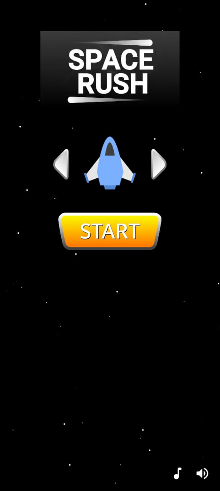
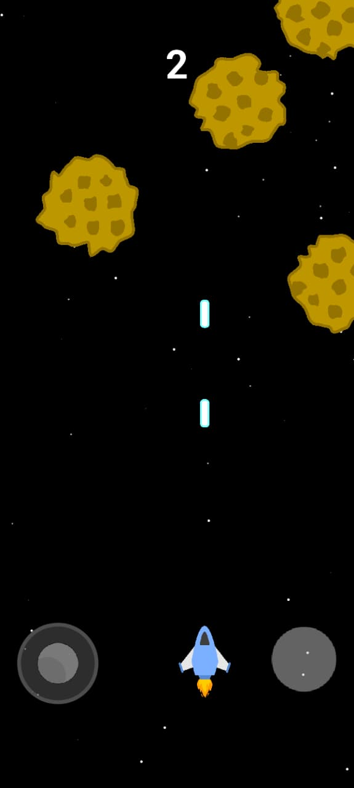
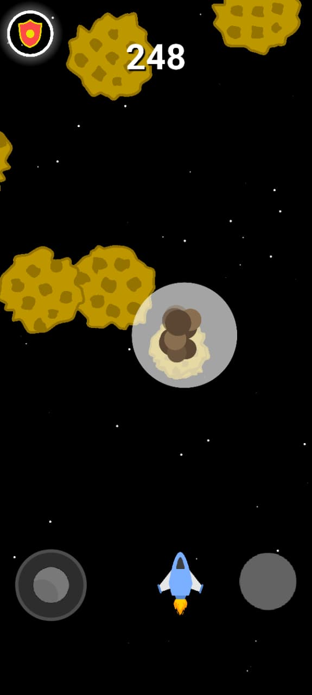

# 🚀 Space Rush

Space Rush is a 2D space shooter game built using Flutter and the Flame game engine. Control a spaceship, shoot incoming asteroids, dodge obstacles, and collect power-ups to survive.

## 📸 Screenshots

| Gameplay | Gameplay | Gameplay |
|:---:|:---:|:---:|
|  |  |  |

## ✨ Features

- **Ship Movement** – Control the spaceship using an on-screen joystick.
- **Shooting Mechanics** – Fire projectiles to destroy incoming asteroids.
- **Asteroid System** – Encounter and destroy asteroids while navigating through space.
- **Power-ups** – Collect items to enhance gameplay.
- **Shield System** – Use protective shields to improve survivability.
- **Bomb Mechanics** – Utilize bombs to deal with incoming obstacles.
- **Explosions** – Visual explosion effects when objects are destroyed.
- **Audio Integration** – Sound effects and background audio.
- **Game Over Screen** – Displays the game-over overlay when the player loses.

## 🛠️ Tech Stack

| Technology | Purpose |
|---|---|
| Flutter | Cross-platform development |
| Dart | Programming language |
| Flame | 2D game engine |
| Flame Audio | Game audio and sound effects |
| Just Audio | Audio playback |
| SharedPreferences | Local data persistence |

## 📂 Project Structure

```text
Space-Rush/
│
├── assets/
│   ├── audio/
│   ├── images/
│   └── ss/
│       ├── img.png
│       ├── img2.png
│       └── img3.png
│
├── lib/
│   ├── components/
│   │   ├── asteroid.dart
│   │   ├── audio_manager.dart
│   │   ├── bomb.dart
│   │   ├── explosion.dart
│   │   ├── laser.dart
│   │   ├── pickup.dart
│   │   ├── player.dart
│   │   ├── shield.dart
│   │   ├── shoot_button.dart
│   │   └── star.dart
│   │
│   ├── overlays/
│   │   ├── game_over_overlay.dart
│   │   └── title_overlay.dart
│   │
│   ├── game.dart
│   └── main.dart
│
├── pubspec.yaml
├── pubspec.lock
└── README.md
```

### Core Components

- **game.dart** – Main game implementation and coordination of gameplay.
- **player.dart** – Handles spaceship behavior and player movement.
- **asteroid.dart** – Implements asteroid components.
- **laser.dart** – Handles projectile mechanics.
- **pickup.dart** – Implements collectible power-ups.
- **shield.dart** – Handles shield functionality.
- **bomb.dart** – Implements bomb mechanics.
- **explosion.dart** – Manages explosion effects.
- **audio_manager.dart** – Handles game audio.
- **title_overlay.dart** – Displays the game title interface.
- **game_over_overlay.dart** – Handles the game-over interface.

## 🚀 Getting Started

### Prerequisites

- Flutter SDK
- Dart SDK
- Android Studio or VS Code

### Installation

1. Clone the repository:

```bash
git clone https://github.com/TaranSingh-111/Space-Rush.git
```

2. Navigate to the project directory:

```bash
cd Space-Rush
```

3. Install dependencies:

```bash
flutter pub get
```

4. Run the game:

```bash
flutter run
```

## 🎯 Project Goals

This project explores game development using Flutter and Flame, focusing on:

- Component-based game architecture.
- Real-time game loops and rendering.
- Player movement and input handling.
- Collision detection and gameplay mechanics.
- Projectile systems and object interactions.
- Collectible power-ups and player abilities.
- Audio integration and game state management.
- Custom game overlays and UI interactions.

## 👨‍💻 Author

**Taran Singh**

[GitHub](https://github.com/TaranSingh-111)